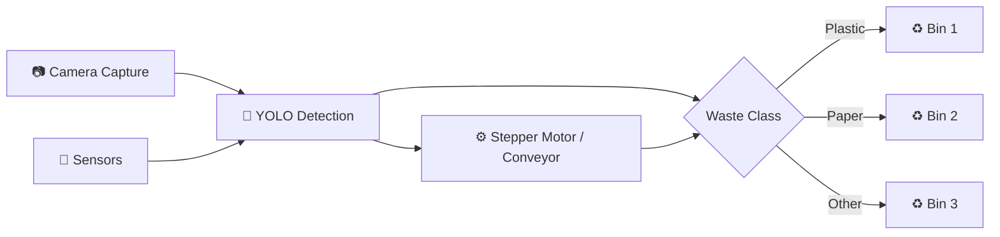
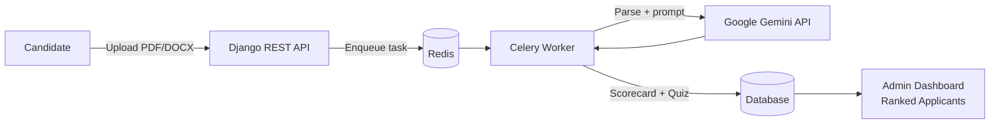
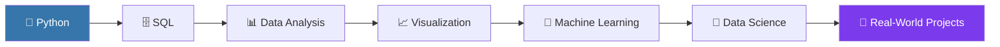

<!-- ===================== HEADER ===================== -->
<div align="center">


<a href="https://git.io/typing-svg">
  
</a>

<br/>


<br/><br/>

<a href="mailto:shalahthaikkadan@gmail.com"></a>
<a href="https://www.linkedin.com/in/shalah-thaikkadan-40142b32b/"></a>
<a href="https://github.com/shalahthaikkadan"></a>

</div>

---

## 👨‍💻 About Me

I'm a **B.Tech Computer Science & Engineering** graduate from **Royal College of Engineering and Technology, Kerala**, passionate about building practical software, learning new technologies, and turning ideas into real-world projects.

```python
class MohammadShalah:
    role       = "Computer Science Engineer"
    focus      = ["Python", "Backend Development", "Data Science", "AI & Automation"]
    experience = ["Web Apps", "REST APIs", "Computer Vision", "IoT / Embedded"]
    learning   = ["SQL", "Data Analysis", "Data Visualization", "Machine Learning"]
    open_to    = ["Python Developer", "Data Analyst", "Backend Developer", "ML roles"]
    philosophy = "Learn → Build → Break → Fix → Improve → Repeat"

    def current_goal(self):
        return "Turn strong fundamentals into real-world, production-grade projects 🚀"
```

---

## 🛠️ Tech Stack

<div align="center">

| Category | Technologies |
|:--|:--|
| **💻 Languages** |  |
| **⚙️ Backend** |  |
| **🌐 Frontend** |  |
| **🗄️ Databases** |  |
| **🤖 AI / Vision** |    |
| **🔌 Hardware / IoT** |  |
| **☁️ DevOps & Tools** |  |

</div>

---

## 🚀 Featured Projects

<table>
<tr>
<td width="50%" valign="top">

### 🌊 Career Sea
AI-powered career discovery platform with personalized pathways, learning roadmaps, and an interactive AI mentor. *(Team project — contributor)*

**Stack:** `React` `Vite` `TypeScript` `Tailwind CSS` `Cloudflare Workers` `PostgreSQL` `Gemini API`

- 🧭 Three career directions per assessment (mainstream, adjacent, wildcard)
- 🗺️ Step-by-step roadmaps with study guides
- 💬 Context-aware AI mentor chat
- 🔐 JWT authentication
- ⚡ Edge architecture + CI/CD via GitHub Actions

[](https://github.com/shalahthaikkadan/Career-Sea)
[](https://careersea.in)

</td>
<td width="50%" valign="top">

### 📄 AI Resume Analyzer
AI-powered recruitment platform that analyzes, scores, and ranks resumes, then generates a personalized technical quiz for each candidate.

**Stack:** `Python` `Django REST Framework` `Celery` `Redis` `Gemini API` `Tailwind CSS` `JavaScript`

- 📑 PDF & DOCX resume parsing
- 🧠 AI scorecard (skills, experience, red flags, positives)
- 📝 Auto-generated 10-question quiz per candidate
- 📊 Admin dashboard ranked by AI score
- ⚡ Async processing with Celery + Redis
- 🔐 JWT authentication

[](https://github.com/shalahthaikkadan/Resume-Analyzer)

</td>
</tr>
<tr>
<td colspan="2" valign="top">

### 🗑️ AI-Based Smart Waste Segregation System
An intelligent hardware + AI system that automatically detects and sorts waste on a conveyor.

**Stack:** `Python` `YOLO` `OpenCV` `Raspberry Pi` `Picamera2` `Sensors` `Stepper Motor`



</td>
</tr>
</table>

<details>
<summary><b>🔎 Architecture overview — AI Resume Analyzer</b></summary>



</details>

---

## 📊 GitHub Analytics

<div align="center">


<br/>


<br/>


</div>

---

## 🧭 Learning Roadmap



| Area | Status |
|:--|:--|
| Python & Backend (Flask, Django) | 🟢 Building projects |
| SQL & Databases (MySQL, PostgreSQL) | 🟢 Working knowledge |
| Computer Vision & IoT | 🟢 Hands-on project experience |
| Data Analysis & Visualization | 🟡 In progress |
| Machine Learning & Data Science | 🟡 In progress |

---

## 🎯 Career Interests

<div align="center">


</div>

---

## 💡 Philosophy

> **Learn → Build → Break → Fix → Improve → Repeat.**

The best way to learn technology is through practical projects, problem solving, experimentation, and continuous improvement.

---

## 🤝 Let's Connect

I'm open to **opportunities, collaborations, and conversations** around Python, backend, data, and AI.

| | |
|:--|:--|
| 📧 **Email** | [shalahthaikkadan@gmail.com](mailto:shalahthaikkadan@gmail.com) |
| 💼 **LinkedIn** | [linkedin.com/in/shalah-thaikkadan-40142b32b](https://www.linkedin.com/in/shalah-thaikkadan-40142b32b/) |
| 🐙 **GitHub** | [github.com/shalahthaikkadan](https://github.com/shalahthaikkadan) |

<div align="center">

⭐ If you find my projects useful, feel free to **star** the repositories!

**Keep Learning. Keep Building. Keep Growing.** 🚀


</div>
