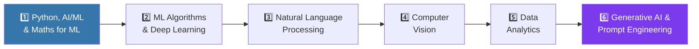

<!-- ===================== HEADER ===================== -->

 

  

---

# 👋 Hi, I'm Mohammad Shalah

### 💻 Computer Science Engineer | Python Developer | Data Science Enthusiast

Welcome to my GitHub profile! 🚀

I'm a Computer Science & Engineering graduate passionate about building practical software solutions, learning new technologies, and turning ideas into real-world projects.

I enjoy working with **Python, Data Science, Web Development, SQL, Git, IoT, and AI-based applications**.

---

## 👨‍💻 About Me

🎓 **B.Tech in Computer Science & Engineering**
🏫 Royal College of Engineering and Technology, Kerala
🐍 Passionate about **Python & Software Development**
📊 Exploring **Data Science & Data Analytics**
🌐 Interested in **Web & Backend Development**
🤖 Experience with **AI, IoT & Computer Vision**
🛠️ Building practical projects to improve my development skills
📚 Continuously learning through coding, projects, and problem solving

---

## 🛠️ Tech Stack

| Category | Technologies |
|:--|:--|
| **💻 Languages** |  |
| **⚙️ Backend** |  |
| **🌐 Frontend** |  |
| **🗄️ Database** |  |
| **📊 Data Science** |     |
| **🤖 AI / Vision** |   |
| **🔌 Hardware** |  |
| **🔧 Tools** |  |

---

## 🚀 Featured Projects

<table>
<tr>
<td width="50%" valign="top">

### 🌊 Career Sea
AI-powered career discovery platform with personalized career pathways, learning roadmaps, and interactive AI mentoring. *(Team project — contributor)*

**Stack:** `React` `Tailwind CSS` `JavaScript` `Gemini API`

</td>
<td width="50%" valign="top">

### 📄 AI Resume Analyzer
Analyzes, scores, and ranks resumes, then generates a personalized technical quiz for each candidate.

**Stack:** `Python` `Django REST Framework` `Gemini API` `Tailwind CSS` `JavaScript`

</td>
</tr>
<tr>
<td width="50%" valign="top">

### 💰 Smart Payroll Management System
Full-stack payroll system for processing salaries, incentives, and deductions with automated calculations and an admin approve/reject workflow.

**Stack:** `Python` `Django REST Framework` `React` `Tailwind CSS` `Pandas`

</td>
<td width="50%" valign="top">

### 📈 E-Commerce Data Analysis
Exploratory data analysis, cleaning, outlier treatment, feature engineering, and encoding of an e-commerce dataset (1200 rows, 14 → 47 columns).

**Stack:** `Python` `Pandas` `NumPy` `Matplotlib` `Seaborn` `Jupyter`

</td>
</tr>
<tr>
<td width="50%" valign="top">

### 🗑️ AI-Based Smart Waste Segregation
Detects and sorts waste automatically using computer vision on a Raspberry Pi with a sensor-driven conveyor.

**Stack:** `Python` `YOLO` `OpenCV` `Raspberry Pi` `Picamera2` `Stepper Motor`

</td>
<td width="50%" valign="top">

### 🤖 RCET College Chatbot
Python + Flask chatbot that answers student queries about Royal College of Engineering and Technology using NLP and a trained intent-based model.

**Stack:** `Python` `Flask` `NLP` `MySQL` `HTML` `CSS`

</td>
</tr>
</table>

---

## 🧭 Currently Learning — AI & Machine Learning Roadmap

| # | Module | Focus Areas | Where I'm applying it |
|:-:|:--|:--|:--|
| 1 | **Python, AI/ML & Maths** | Python programming, intro to AI & ML, mathematics for ML | Core of every project |
| 2 | **ML Algorithms & Techniques** | Supervised & unsupervised learning, deep learning fundamentals, practicals | Next step after data prep |
| 3 | **Natural Language Processing** | NLP basics, advanced NLP, spaCy & NLTK, NLP project | [RCET College Chatbot](https://github.com/shalahthaikkadan/College-chatbot) |
| 4 | **Computer Vision** | CV fundamentals, object detection with YOLO, image classification with ResNet, CV project | [Waste Segregation System](https://github.com/shalahthaikkadan/-AI-Based-Smart-Waste-Segregation-System) |
| 5 | **Data Analytics** | Data collection & cleaning, exploratory data analysis (EDA), analytics project | [E-Commerce Data Analysis](https://github.com/shalahthaikkadan/E-Commerce-Data-Analysis) |
| 6 | **Generative AI & Prompt Engineering** | Generative models (GANs), crafting effective prompts for AI models | [Resume Analyzer](https://github.com/shalahthaikkadan/Resume-Analyzer) · [Career Sea](https://github.com/shalahthaikkadan/Career-Sea) |

**Tools on the roadmap**

 

---

## 🎯 Career Interests

---

## 📈 GitHub Stats

 

---

## 💡 My Philosophy

> **Learn → Build → Break → Fix → Improve → Repeat.**

I believe the best way to learn technology is through practical projects, problem solving, experimentation, and continuous improvement.

---

## 🌐 Connect With Me

| | |
|:--|:--|
| 📧 **Email** | [shalahthaikkadan@gmail.com](mailto:shalahthaikkadan@gmail.com) |
| 💼 **LinkedIn** | [linkedin.com/in/shalah-thaikkadan-40142b32b](https://www.linkedin.com/in/shalah-thaikkadan-40142b32b/) |
| 🐙 **GitHub** | [github.com/shalahthaikkadan](https://github.com/shalahthaikkadan) |

⭐ If you find my projects useful, feel free to **star** the repositories.

**Keep Learning. Keep Building. Keep Growing.** 🚀

